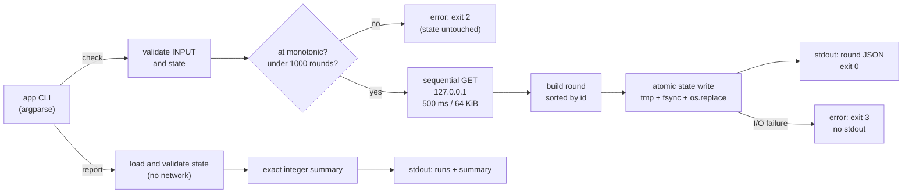

# local-uptime

A small, offline uptime monitor for **loopback HTTP endpoints**. It performs one
sequential round of `GET` requests against `127.0.0.1`, records the outcome in a
local JSON file, and prints history plus a per-endpoint summary. There is no
SaaS, scheduler, notification channel, credential, daemon or Internet access.

- Spec: **v0.1.4** (issue #24)
- Product version: **0.1.0**
- Runtime: **Python 3.12**, standard library only
- Platform: **POSIX** — Ubuntu and macOS (native Windows is out of scope)

## Problem and scope

When you develop a service locally, you often want a tiny record of whether its
health endpoint answered during a change or a test run. `local-uptime` does
exactly that and nothing more:

1. read a JSON list of local HTTP targets;
2. probe each one once (500 ms timeout, at most 65536 bytes read, redirects not
   followed);
3. append the round to a JSON history, atomically;
4. report the stored rounds and an exact integer summary.

Time is an explicit `--at` argument in milliseconds; the tool never reads the
wall clock. HTTP failures are data (`status: null`, `up: false`), not CLI errors.
The history is capped at 1000 rounds and assumes a single writer.

## Quickstart

```sh
# From the repository root. Start any local HTTP server for the demo:
mkdir -p demo && echo "hello" > demo/index.html
(cd demo && python -m http.server 8000 --bind 127.0.0.1) &
SERVER_PID=$!

cat > targets.json <<'JSON'
[{"id":"api","port":8000,"path":"/"}]
JSON

python app check targets.json --state state.json --at 0
# {"at":0,"results":[{"id":"api","status":200,"up":true}]}

python app report --state state.json
# {"runs":[{"at":0,"results":[{"id":"api","status":200,"up":true}]}],"summary":[{"id":"api","checks":1,"up":1,"down":0}]}

kill $SERVER_PID
```

A failing probe still exits `0` and is recorded as data:

```sh
cat > targets.json <<'JSON'
[{"id":"api","port":8000,"path":"/"},{"id":"dead","port":9,"path":"/health"}]
JSON
python app check targets.json --state state.json --at 1000
# {"at":1000,"results":[{"id":"api","status":null,"up":false},{"id":"dead","status":null,"up":false}]}
```

(`./app` and `python app` are equivalent; the file is executable with a
`#!/usr/bin/env python3` shebang.)

## CLI

```
python app --version      # local-uptime 0.1.0
python app --help
python app check INPUT --state STATE --at MS
python app report --state STATE
```

### `check INPUT --state STATE --at MS`

`INPUT` is a JSON array of 0–100 objects, each exactly:

```json
{"id":"api","port":9000,"path":"/health"}
```

| Field  | Rule |
|--------|------|
| `id`   | unique, ASCII `[a-z][a-z0-9-]{0,31}` |
| `port` | integer 1–65535 (a JSON boolean is not an integer) |
| `path` | ASCII, starts with `/`, 1–256 chars, no control characters, space, `#`, `\`, and no `//` prefix |

`MS` is an integer `0..9007199254740991` and must be strictly greater than the
last stored `at` (the first round may use `0`). The state file is created when
missing (equivalent to `{"runs":[]}`). A 1001st round is rejected with exit `2`
before any network access.

Output on success (one line, LF):

```json
{"at":0,"results":[{"id":"api","status":200,"up":true}]}
```

- `200..299` → `up: true`, status preserved.
- any other final status (e.g. `302`, `503`) → `up: false`, status preserved;
  redirects are never followed.
- timeout (500 ms), connection refused, protocol error, or a response body
  larger than 65536 bytes → `status: null`, `up: false`.

Results are sorted by ascending ASCII `id`. The round is printed only after the
state file has been committed.

### `report --state STATE`

Opens no connection. Returns the stored rounds plus a summary sorted by `id`,
covering every ID ever seen:

```json
{"runs":[...],"summary":[{"id":"api","checks":2,"up":1,"down":1}]}
```

`down` is always `checks - up`; an ID absent from a round is not counted as a
failure. A missing state file is an I/O error (`3`).

## Exit codes and error contract

| Code | Meaning |
|------|---------|
| `0`  | success (even if every endpoint is down) |
| `2`  | invalid argument, INPUT, `--at`, or round limit |
| `3`  | I/O error or corrupt/unreadable state |

On errors stdout is empty and stderr is a single line starting with `error:`,
with no traceback. Validation happens before any mutation or request.

## Persistence

The state file is exactly `{"runs":[ROUND,...]}` with rounds in `--at` order.
Writes use a temporary file **in the same directory**, `flush`, `fsync`, close
and `os.replace`; a failure before replacement leaves the original bytes intact
and removes the temporary file when possible. The destination is never opened
in truncation mode. INPUT files are read-only. Missing parent directories are
I/O errors. Unicode and space-containing file paths are supported.

## Limits

- 1000 rounds per state file; 100–1000 results per round via INPUT.
- One sequential probe at a time; one writer per state file; no daemon.
- 500 ms per probe; 65536 bytes of response body.
- No credentials, external telemetry, notifications, scheduler or shell
  interpolation of data.
- Physical disk failure and simultaneous writers are outside the contract.

## Development

Preparation only (network is used only while preparing the environment):

```sh
python -m pip install pytest==9.0.3 ruff==0.15.22
```

Lint, format and test from the repository root:

```sh
python -m ruff check .
python -m ruff format --check .
python -m pytest
```

`pytest` is the single documented test command; it runs the black-box suite in
`tests/`. Every test invokes the CLI through a subprocess with `sys.executable`,
uses loopback servers on ephemeral ports, and gets its own temporary directory.
Tests are named after the acceptance criterion they cover (`AC-1` … `AC-14`).
The write-failure test (AC-12) makes a directory read-only and skips with a
justified reason when the suite runs as root, where permissions cannot fail a
write.

CI (`.github/workflows/ci.yml`) runs the same lint and test commands on
`ubuntu-latest` and `macos-latest` with Python 3.12 and `PYTHONUTF8=1`.

## Architecture



## Design decisions

- **One file, standard library.** `app` is a self-contained Python 3.12 script,
  which keeps the runtime manifest empty and the entrypoint trivial to audit.
- **Strict JSON.** Duplicate keys, `NaN`/`Infinity`, BOMs, extra object fields
  and `true` used as an integer are rejected. This prevents silent data loss
  and ambiguous persisted history.
- **Failures are data.** Network outcomes never change the exit code of a
  successful check; only invalid input or I/O does.
- **Explicit time.** `--at` makes runs deterministic and testable without
  clock precision.
- **Atomic state.** A crash or write error cannot leave a partial round or
  truncate the previous history.
- **No server mode.** The product is a single-round monitor, not a daemon; no
  HTTP server, scheduler or shutdown endpoint is provided.

## How this was built

- **Implementation:** written by an AI coding agent (Claude Code harness) in a
  headless run. Observed model at authoring time: `deepseek-flash`.
- **Public tests:** authored in the same run by the implementing agent, driven
  only through the documented CLI/loopback interface and mapped to AC-1…AC-14.
- **Hidden tests:** per spec §7.8 these are external, authored by a different
  model family, and were not available for or used during implementation.
- **Human participation:** the maintainer owns review, tagging and release;
  human edits to this run are not asserted here and are recorded in
  [`RUNS.md`](RUNS.md) where known.
- No human authorship, model-family independence, or future results are
  claimed beyond what is recorded in `RUNS.md`.

## License

MIT — see [LICENSE](LICENSE).
